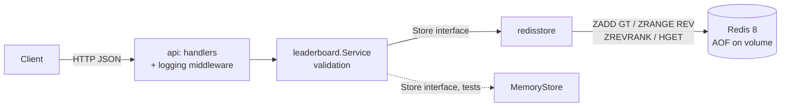

# Leaderboard Service

[](https://github.com/agahatay/leaderboard/actions/workflows/ci.yml)

A game leaderboard HTTP service written in Go and backed by Redis sorted sets.
Players submit scores; clients read the top N and a player's rank.

Status: **v0.1**. Synchronous writes to Redis. The async ingest pipeline,
API key auth, `/readyz` and the "around" endpoint are planned for v0.2.

## Quick start

Requires Docker with Compose v2.

```sh
docker compose up --build
```

The API listens on `localhost:8080`; Redis runs with AOF persistence on a
named volume, so scores survive `docker compose down` / `up`.

```sh
# Submit a score (only kept if it beats the player's current best)
curl -X POST localhost:8080/v1/leaderboards/global/scores \
  -d '{"player_id":"alice","score":1200}'

# Top 10
curl "localhost:8080/v1/leaderboards/global/top?limit=10"

# One player's rank and score
curl localhost:8080/v1/leaderboards/global/players/alice
```

## API

All responses are JSON. Errors look like `{"error": "message"}`.

| Method and path | Behaviour |
| --- | --- |
| `POST /v1/leaderboards/{board}/scores` | Body `{"player_id","score"}`. Writes synchronously, returns 200. |
| `GET /v1/leaderboards/{board}/top?limit=10` | `{"entries":[{rank, player_id, name, score}]}`. `limit` 1..100, default 10. |
| `GET /v1/leaderboards/{board}/players/{player}` | `{rank, score}`. 404 if the player is not on the board. |
| `PUT /v1/players/{player}` | Body `{"name"}`. Display name shown in top lists. |
| `GET /healthz` | Liveness: 200 while the process runs. |

Validation: board and player IDs match `^[a-zA-Z0-9_-]{1,64}$`; score is an
integer from 0 to 10^12; names are 1 to 64 characters. Invalid input gets 400
with a message naming the field. Request bodies are limited to 4 KiB (413),
unknown JSON fields are rejected.

## Architecture



| Path | Role |
| --- | --- |
| `cmd/server` | Config, wiring, HTTP server, `-healthcheck` flag |
| `internal/api` | Routes, handlers, JSON helpers, request logging |
| `internal/leaderboard` | Domain types, validation, `Service`, `Store` interface, `MemoryStore` |
| `internal/leaderboard/storetest` | Behaviour suite every `Store` must pass |
| `internal/store/redisstore` | `Store` on Redis |
| `internal/config` | Environment variables with defaults and validation |

### Redis keys

- `lb:{board}`: sorted set, member = player ID, score = score.
- `player:{id}`: hash with field `name`.

## Design decisions and their costs

- **Best-score writes with `ZADD GT`.** A score only replaces a higher one,
  so retrying a request is harmless. Cost: a board cannot store "latest" or
  cumulative scores; that would need a different command.
- **Rank and score read in one `MULTI/EXEC`.** Both values come from the same
  moment. Cost: one transaction instead of a plain pipeline.
- **Names fetched in one pipeline after `ZRANGE`.** One extra round trip for
  a top list, never N. Cost: names live in a separate key, so a top list can
  briefly show an old name while it is being changed.
- **Per-call Redis timeout (`REDIS_TIMEOUT`, default 200ms).** A slow Redis
  turns into fast 500s instead of piled-up requests. Cost: a timeout under
  load is an error the client must retry.
- **Startup does not fail when Redis is down.** The process stays up and
  returns 500 until Redis is reachable; Compose waits for a healthy Redis
  before starting the API.
- **One shared test suite for all stores.** `MemoryStore` and the Redis store
  run the same behaviour tests, including tie ordering, so unit tests on the
  memory store reflect production behaviour.
- **Distroless runtime image.** No shell or package manager in production
  (about 20 MB). Cost: no `curl` for health checks, so the binary has a
  `-healthcheck` mode.

## Configuration

| Variable | Default | Notes |
| --- | --- | --- |
| `PORT` | `8080` | 1..65535 |
| `REDIS_ADDR` | `localhost:6379` | |
| `REDIS_PASSWORD` | empty | Put real values in `.env` (gitignored), see `.env.example` |
| `REDIS_TIMEOUT` | `200ms` | Go duration, must be positive |

Invalid values stop the process at startup with all problems listed.

## Running tests

```sh
go test -race ./...                         # unit tests; Redis tests are skipped
docker compose up -d redis                  # Redis on 127.0.0.1:6379
REDIS_ADDR=localhost:6379 go test -race ./...   # also runs Redis integration tests
golangci-lint run                           # config in .golangci.yml
```

On Windows, `-race` needs cgo and a C compiler (for example MSYS2 UCRT64 gcc)
on `PATH`. Integration tests use board and player IDs derived from the test
name and delete their keys afterwards.

CI (GitHub Actions) runs the gofmt check, `go vet`, golangci-lint,
`go test -race` against a Redis service container, and a Docker build.

## Measured results

Not measured yet. A load generator and real sync vs async numbers are planned
for phase 4; they will be listed here with date, machine and exact command.

## Known limitations

- **Equal scores are ordered by player ID** (descending, Redis `REV` order),
  not by who reached the score first.
- No authentication yet: anyone who can reach the API can write scores
  (API key middleware is planned for v0.2).
- No graceful shutdown yet; in-flight requests are cut off on stop.
- Redis in `docker-compose.yml` has no password and is bound to `127.0.0.1`.
  It is meant for local development only.
- One Redis instance, no replication.

## How this was built

The code was written with [Claude Code](https://claude.com/claude-code) under
my direction: I set the requirements, the phases and the conventions in
`CLAUDE.md`, and approved each plan before it was implemented.

What I reviewed and tested myself: _TODO (to be filled in by me)._
