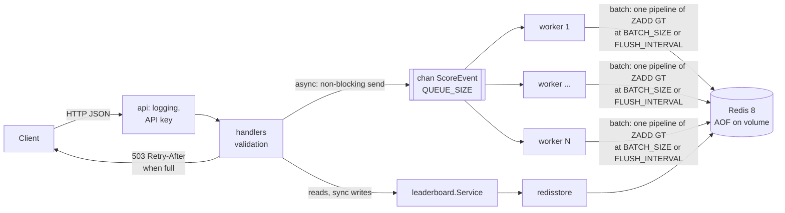

# Leaderboard Service

[](https://github.com/agahatay/leaderboard/actions/workflows/ci.yml)

A game leaderboard HTTP service written in Go and backed by Redis sorted sets.
Players submit scores; clients read the top N, a player's rank, and the
players around them. Score writes go through a bounded in-memory queue and a
pool of worker goroutines that write to Redis in batches.

Status: **v0.2**. Async ingest, graceful shutdown, API key auth,
readiness probe, "around" endpoint.

## Quick start

Requires Docker with Compose v2 and `openssl` (Git Bash has it).

```sh
export API_KEY=$(openssl rand -hex 24)
echo "API_KEY=$API_KEY" > .env        # .env is gitignored
docker compose up --build
```

Compose refuses to start without `API_KEY` in `.env`. The API listens on
`localhost:8080`; Redis runs with AOF persistence on a named volume.

In a second terminal, from the repository folder:

```sh
# A new shell does not have $API_KEY yet; load it from .env
# (without this the POST below gets 401)
set -a; . ./.env; set +a

# Submit a score: 202 Accepted, written to Redis within FLUSH_INTERVAL
curl -X POST localhost:8080/v1/leaderboards/global/scores \
  -H "X-API-Key: $API_KEY" -d '{"player_id":"alice","score":1200}'

# Top 10
curl "localhost:8080/v1/leaderboards/global/top?limit=10"

# Players around alice
curl "localhost:8080/v1/leaderboards/global/players/alice/around?radius=5"
```

## API

All responses are JSON. Errors look like `{"error": "message"}`, including
404 for unknown routes and 405 for a wrong method.

| Method and path | Behaviour |
| --- | --- |
| `POST /v1/leaderboards/{board}/scores` | Body `{"player_id","score"}`. Needs `X-API-Key`. Async mode: 202 when queued; 503 + `Retry-After: 1` when the queue is full or the server is shutting down. Sync mode: 200 after the write. |
| `GET /v1/leaderboards/{board}/top?limit=10` | `{"entries":[{rank, player_id, name, score}]}`. `limit` 1..100, default 10. |
| `GET /v1/leaderboards/{board}/players/{player}` | `{rank, score}`. 404 if the player is not on the board. |
| `GET /v1/leaderboards/{board}/players/{player}/around?radius=5` | `{"entries":[...]}`: the player and up to `radius` players above and below, clamped at the ends. `radius` 1..50, default 5. 404 if not on the board. |
| `PUT /v1/players/{player}` | Body `{"name"}`. Needs `X-API-Key`. |
| `GET /healthz` | Liveness: 200 while the process runs. |
| `GET /readyz` | Readiness: 200 if Redis answers `PING` within 500 ms, else 503. |

Validation: board and player IDs match `^[a-zA-Z0-9_-]{1,64}$`; score is an
integer from 0 to 10^12; names are 1 to 64 characters. Invalid input gets 400
with a message naming the field. Request bodies are limited to 4 KiB (413);
unknown JSON fields are rejected. A missing or wrong API key gets 401.

## Architecture



Shutdown (SIGINT / SIGTERM): stop accepting HTTP and wait for in-flight
requests, then close the channel; workers drain and flush everything queued;
then exit. Both steps share `SHUTDOWN_TIMEOUT`.

| Path | Role |
| --- | --- |
| `cmd/server` | Config, wiring, HTTP server, graceful shutdown, `-healthcheck` flag |
| `internal/api` | Routes, handlers, API key and logging middleware, JSON helpers |
| `internal/ingest` | Bounded queue, worker pool, batched writes with retry |
| `internal/leaderboard` | Domain types, validation, `Service`, `Store` interface, `MemoryStore` |
| `internal/leaderboard/storetest` | Behaviour suite every `Store` must pass |
| `internal/store/redisstore` | `Store` on Redis |
| `internal/config` | Environment variables with defaults and validation |

### Redis keys

- `lb:{board}`: sorted set, member = player ID, score = score.
- `player:{id}`: hash with field `name`.

## Design decisions and their costs

Full records are in [`docs/decisions.md`](docs/decisions.md). In short:

- **Async ingest.** Fewer Redis round trips and visible back-pressure (503)
  instead of growing latency. Cost: a 202 means queued, not stored. Scores
  still in memory are lost if the process crashes; `INGEST_MODE=sync` avoids
  this at the price of one Redis write per request.
- **Graceful shutdown drains the queue.** Proved by a test that cancels the
  server under load and checks every 202-accepted score is stored.
- **`ZADD GT` (best score).** Retries are harmless. Cost: no "latest" or
  cumulative scores.
- **Per-call Redis timeout.** A slow Redis gives fast errors instead of
  piled-up requests.
- **API key compared in constant time** over SHA-256 digests. Cost: one
  shared key, no per-client identity.
- **Separate liveness and readiness.** A Redis outage marks the API not
  ready instead of restarting it.
- **Shared test suite for all stores**, so tests on `MemoryStore` reflect
  Redis behaviour, including tie order.
- **Distroless runtime image** (about 20 MB), so the binary has its own
  `-healthcheck` mode instead of curl.

## Configuration

| Variable | Default | Notes |
| --- | --- | --- |
| `API_KEY` | none | **Required.** Put it in `.env` (gitignored), see `.env.example` |
| `PORT` | `8080` | 1..65535 |
| `REDIS_ADDR` | `localhost:6379` | |
| `REDIS_PASSWORD` | empty | |
| `REDIS_TIMEOUT` | `200ms` | Per Redis call |
| `INGEST_MODE` | `async` | `async` (202, queued) or `sync` (200, written) |
| `QUEUE_SIZE` | `1024` | Channel capacity |
| `WORKERS` | `4` | Writer goroutines |
| `BATCH_SIZE` | `100` | Events per Redis pipeline |
| `FLUSH_INTERVAL` | `50ms` | Max time an event waits in a partial batch |
| `SHUTDOWN_TIMEOUT` | `10s` | Budget for HTTP shutdown plus queue drain |

Invalid values stop the process at startup with all problems listed.

## Running tests

```sh
go test -race ./...                             # unit tests; Redis tests are skipped
docker compose up -d redis                      # Redis on 127.0.0.1:6379
REDIS_ADDR=localhost:6379 go test -race ./...   # also runs Redis integration tests
golangci-lint run                               # config in .golangci.yml
```

Notable tests:

- `internal/ingest`: flush on batch size, flush on interval, drain on close,
  `ErrQueueFull`, retry then success, drop after max attempts, close
  timeout, and many producers racing with `Close`. Time-based tests use
  `testing/synctest`, so they run on a fake clock without sleeping.
- `cmd/server/shutdown_test.go`: the real `serve` function under load from
  16 HTTP clients is cancelled mid-load; every 202-accepted score must be in
  the store.
- `internal/api`: 401 without a key, 503 + `Retry-After` when the queue is
  full, `/readyz` with a hanging Redis.

On Windows, `-race` needs cgo and a C compiler (for example MSYS2 UCRT64 gcc)
on `PATH`. CI (GitHub Actions) runs the gofmt check, `go vet`,
golangci-lint, `go test -race` against a Redis service container, and a
Docker build.

## Measured results

Not measured yet. A load generator and real sync vs async numbers are planned
for phase 4; they will be listed here with date, machine and exact command.

## Known limitations

- **Equal scores are ordered by player ID** (descending, Redis `REV` order),
  not by who reached the score first.
- **Accepted (202) scores can be lost on a crash.** They live in memory until
  their batch is written. A graceful stop drains them; SIGKILL, OOM or power
  loss does not. A batch that still fails after 3 attempts is dropped and
  logged.
- **"Around" is not atomic**: a write between its two Redis calls can shift
  the window by one place.
- One shared API key; no per-client keys or rate limiting.
- Redis in `docker-compose.yml` has no password and is bound to `127.0.0.1`.
  It is meant for local development only.
- One Redis instance, no replication.

## How this was built

The code was written with [Claude Code](https://claude.com/claude-code) under
my direction: I set the requirements, the phases and the conventions in
`CLAUDE.md`, and approved each plan before it was implemented.

What I reviewed and tested myself: _TODO (to be filled in by me)._
