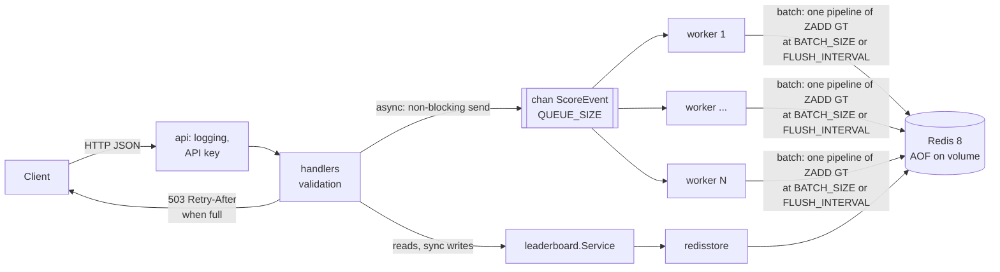
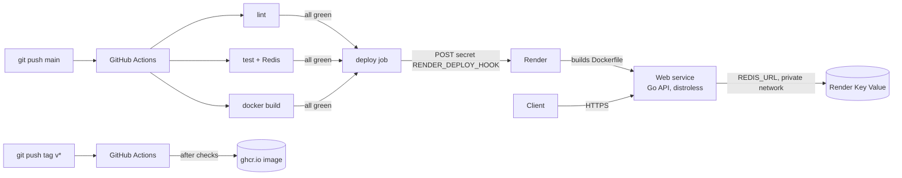

# Leaderboard Service

[](https://github.com/agahatay/leaderboard/actions/workflows/ci.yml)

A game leaderboard HTTP service written in Go and backed by Redis sorted sets.
Players submit scores; clients read the top N, a player's rank, and the
players around them. Score writes go through a bounded in-memory queue and a
pool of worker goroutines that write to Redis in batches.

Status: **v1.0**. Async ingest, graceful shutdown, API key auth,
readiness probe, "around" endpoint, load generator with measured results,
nginx in front of several replicas, image published to GHCR, deployed to
Render by CI.

**Live demo:** <https://leaderboard-lo89.onrender.com>

```sh
curl "https://leaderboard-lo89.onrender.com/v1/leaderboards/global/top?limit=10"
```

> **Note:** the demo runs on Render's free plan. If the service is asleep,
> the first request can take about a minute while it starts. Demo data is
> not persistent: it can disappear at any time.

## Quick start

Requires Docker with Compose v2 and `openssl` (Git Bash has it).

```sh
export API_KEY=$(openssl rand -hex 24)
echo "API_KEY=$API_KEY" > .env        # .env is gitignored
docker compose up --build
```

Compose refuses to start without `API_KEY` in `.env`. The API listens on
`localhost:8080`; Redis runs with AOF persistence on a named volume.

In a second terminal, from the repository folder:

```sh
# A new shell does not have $API_KEY yet; load it from .env
# (without this the POST below gets 401)
set -a; . ./.env; set +a

# Submit a score: 202 Accepted, written to Redis within FLUSH_INTERVAL
curl -X POST localhost:8080/v1/leaderboards/global/scores \
  -H "X-API-Key: $API_KEY" -d '{"player_id":"alice","score":1200}'

# Top 10
curl "localhost:8080/v1/leaderboards/global/top?limit=10"

# Players around alice
curl "localhost:8080/v1/leaderboards/global/players/alice/around?radius=5"
```

## API

All responses are JSON. Errors look like `{"error": "message"}`, including
404 for unknown routes and 405 for a wrong method.

| Method and path | Behaviour |
| --- | --- |
| `POST /v1/leaderboards/{board}/scores` | Body `{"player_id","score"}`. Needs `X-API-Key`. Async mode: 202 when queued; 503 + `Retry-After: 1` when the queue is full or the server is shutting down. Sync mode: 200 after the write. |
| `GET /v1/leaderboards/{board}/top?limit=10` | `{"entries":[{rank, player_id, name, score}]}`. `limit` 1..100, default 10. |
| `GET /v1/leaderboards/{board}/players/{player}` | `{rank, score}`. 404 if the player is not on the board. |
| `GET /v1/leaderboards/{board}/players/{player}/around?radius=5` | `{"entries":[...]}`: the player and up to `radius` players above and below, clamped at the ends. `radius` 1..50, default 5. 404 if not on the board. |
| `PUT /v1/players/{player}` | Body `{"name"}`. Needs `X-API-Key`. |
| `GET /healthz` | Liveness: 200 while the process runs. Body `{"status":"ok","commit":"<git SHA>"}` shows which commit is running. |
| `GET /readyz` | Readiness: 200 if Redis answers `PING` within 500 ms, else 503. |

Validation: board and player IDs match `^[a-zA-Z0-9_-]{1,64}$`; score is an
integer from 0 to 10^12; names are 1 to 64 characters. Invalid input gets 400
with a message naming the field. Request bodies are limited to 4 KiB (413);
unknown JSON fields are rejected. A missing or wrong API key gets 401.

## Architecture



Shutdown (SIGINT / SIGTERM): stop accepting HTTP and wait for in-flight
requests, then close the channel; workers drain and flush everything queued;
then exit. Both steps share `SHUTDOWN_TIMEOUT`.

| Path | Role |
| --- | --- |
| `cmd/server` | Config, wiring, HTTP server, graceful shutdown, `-healthcheck` flag |
| `cmd/loadgen` | Load generator: N clients, one collector, latency percentiles |
| `compose.lb.yml`, `deploy/nginx` | nginx in front of `--scale api=N` |
| `internal/api` | Routes, handlers, API key and logging middleware, JSON helpers |
| `internal/ingest` | Bounded queue, worker pool, batched writes with retry |
| `internal/leaderboard` | Domain types, validation, `Service`, `Store` interface, `MemoryStore` |
| `internal/leaderboard/storetest` | Behaviour suite every `Store` must pass |
| `internal/store/redisstore` | `Store` on Redis |
| `internal/config` | Environment variables with defaults and validation |

### Redis keys

- `lb:{board}`: sorted set, member = player ID, score = score.
- `player:{id}`: hash with field `name`.

## Design decisions and their costs

Full records are in [`docs/decisions.md`](docs/decisions.md). In short:

- **Async ingest.** Fewer Redis round trips and visible back-pressure (503)
  instead of growing latency. Cost: a 202 means queued, not stored. Scores
  still in memory are lost if the process crashes; `INGEST_MODE=sync` avoids
  this at the price of one Redis write per request.
- **Graceful shutdown drains the queue.** Proved by a test that cancels the
  server under load and checks every 202-accepted score is stored.
- **`ZADD GT` (best score).** Retries are harmless. Cost: no "latest" or
  cumulative scores.
- **Per-call Redis timeout.** A slow Redis gives fast errors instead of
  piled-up requests.
- **API key compared in constant time** over SHA-256 digests. Cost: one
  shared key, no per-client identity.
- **Separate liveness and readiness.** A Redis outage marks the API not
  ready instead of restarting it.
- **Shared test suite for all stores**, so tests on `MemoryStore` reflect
  Redis behaviour, including tie order.
- **Distroless runtime image** (about 20 MB), so the binary has its own
  `-healthcheck` mode instead of curl.

## Deploy (Render)



- **Web service:** Render builds the same `Dockerfile` as local and CI. The
  server listens on the `PORT` Render sets. Render's health check uses
  `/healthz` (liveness), not `/readyz`: restarting the API does not fix a
  Key Value outage (decision 8 in [`docs/decisions.md`](docs/decisions.md)).
- **Key Value:** Render's Redis-compatible store. Its internal URL goes into
  `REDIS_URL`; the API reaches it over Render's private network.
- **Deploys come from CI only.** Render's auto-deploy is off. The `deploy`
  job in `.github/workflows/ci.yml` runs on pushes to `main` after lint,
  tests and the Docker build pass, and POSTs to the deploy hook stored in the
  `RENDER_DEPLOY_HOOK` secret with `ref=<commit SHA>`, so Render deploys
  exactly the commit that passed. The job log shows the HTTP status and the
  Render deploy ID, never the hook URL. Without the secret the job is
  skipped.
- **Which commit is live:** `curl https://leaderboard-lo89.onrender.com/healthz`
  returns the commit SHA. Images built by CI get it from
  `--build-arg COMMIT=<sha>`; on Render it comes from `RENDER_GIT_COMMIT` at
  runtime; a local `go build` in a git checkout uses Go's VCS stamp (with
  `-dirty` for uncommitted changes); otherwise it is `unknown`.
- **Shutdown:** Render sends SIGTERM before it replaces an instance; the
  queue drain from the graceful shutdown applies there too.

## Configuration

| Variable | Default | Notes |
| --- | --- | --- |
| `API_KEY` | none | **Required.** Put it in `.env` (gitignored), see `.env.example` |
| `PORT` | `8080` | 1..65535 |
| `REDIS_URL` | empty | If set, replaces `REDIS_ADDR` and `REDIS_PASSWORD`: `redis://[user:password@]host:port[/db]`, or `rediss://` for TLS. Never logged |
| `REDIS_ADDR` | `localhost:6379` | |
| `REDIS_PASSWORD` | empty | |
| `REDIS_TIMEOUT` | `200ms` | Per Redis call |
| `INGEST_MODE` | `async` | `async` (202, queued) or `sync` (200, written) |
| `QUEUE_SIZE` | `1024` | Channel capacity |
| `WORKERS` | `4` | Writer goroutines |
| `BATCH_SIZE` | `100` | Events per Redis pipeline |
| `FLUSH_INTERVAL` | `50ms` | Max time an event waits in a partial batch |
| `SHUTDOWN_TIMEOUT` | `10s` | Budget for HTTP shutdown plus queue drain |

Invalid values stop the process at startup with all problems listed.

## Running tests

```sh
go test -race ./...                             # unit tests; Redis tests are skipped
docker compose up -d redis                      # Redis on 127.0.0.1:6379
REDIS_ADDR=localhost:6379 go test -race ./...   # also runs Redis integration tests
golangci-lint run                               # config in .golangci.yml
```

Notable tests:

- `internal/ingest`: flush on batch size, flush on interval, drain on close,
  `ErrQueueFull`, retry then success, drop after max attempts, close
  timeout, and many producers racing with `Close`. Time-based tests use
  `testing/synctest`, so they run on a fake clock without sleeping.
- `cmd/server/shutdown_test.go`: the real `serve` function under load from
  16 HTTP clients is cancelled mid-load; every 202-accepted score must be in
  the store.
- `internal/api`: 401 without a key, 503 + `Retry-After` when the queue is
  full, `/readyz` with a hanging Redis.

On Windows, `-race` needs cgo and a C compiler (for example MSYS2 UCRT64 gcc)
on `PATH`. CI (GitHub Actions) runs the gofmt check, `go vet`,
golangci-lint, `go test -race` against a Redis service container, and a
Docker build. On `v*` tags, once all of those pass, it pushes the image to
GitHub Container Registry as `ghcr.io/agahatay/leaderboard:<version>`. On
pushes to `main`, once they pass, it triggers the Render deploy (see
"Deploy (Render)").

## Measured results

All numbers below are copied from `cmd/loadgen` output. The raw output of
every run is in [`docs/benchmarks/2026-11-24/`](docs/benchmarks/2026-11-24/).

**Environment.** Measured on 2026-11-24 on **one machine**: the API and
Redis 8 ran in Docker Compose, and loadgen ran on the same host and sent
requests to `localhost:8080`. Network latency between machines is not part of
these numbers. Treat them as a comparison between the two modes on this
machine, not as production capacity.

| | |
| --- | --- |
| CPU | 11th Gen Intel Core i7-11800H @ 2.30GHz, 8 cores / 16 threads |
| RAM | 31.7 GB (Docker Desktop VM: 16 CPUs, 15.5 GiB) |
| OS | Windows 11 Home Single Language 10.0.26300, Docker Desktop (WSL2 kernel 5.15.167.4) |
| Go / Docker | go1.27.4 (loadgen), Docker 29.9.3, Compose v5.7.0 |
| Service config | defaults: `QUEUE_SIZE=1024`, `WORKERS=4`, `BATCH_SIZE=100`, `FLUSH_INTERVAL=50ms`; JSON request log on |

**Commands.** Each mode had a 5 s warm-up run first and started with an
empty Redis (`FLUSHALL`). loadgen is closed-loop: each of the 50 clients
sends its next request only after the previous response.

```sh
INGEST_MODE=sync  docker compose up -d --build --wait   # then, for async:
INGEST_MODE=async docker compose up -d --wait api
set -a; . ./.env; set +a
go build -o loadgen.exe ./cmd/loadgen
./loadgen.exe -c 50 -d 30s -board sync                 # -board async for async
```

**Results** (50 clients, 30 s, 10,000 player IDs, two runs per mode):

| Mode | Run | Requests | Throughput | Errors | p50 | p95 | p99 | max |
| --- | --- | --- | --- | --- | --- | --- | --- | --- |
| sync (200) | 1 | 713,745 | 23,790.7 req/s | 0 | 1.85 ms | 4.09 ms | 5.9 ms | 66.99 ms |
| sync (200) | 2 | 754,219 | 25,139.3 req/s | 0 | 1.74 ms | 3.74 ms | 5.3 ms | 49.95 ms |
| async (202) | 1 | 864,255 | 28,807.7 req/s | 0 | 1.56 ms | 3.69 ms | 5.41 ms | 55.39 ms |
| async (202) | 2 | 866,219 | 28,873.1 req/s | 0 | 1.56 ms | 3.68 ms | 5.26 ms | 51.88 ms |

**Read the latency columns with care.** The two modes do not measure the same
work:

- **sync** latency includes the Redis write (`ZADD GT`): a 200 means stored.
- **async** latency covers only validation and putting the event on the
  queue: a 202 means queued. The Redis write happens later in a worker
  batch, up to `FLUSH_INTERVAL` (50 ms) plus the pipeline time after the
  response, and **is not in these numbers**.

So async does not make writes faster; it moves the write off the request
path and groups up to 100 writes into one Redis round trip. On this machine
that gave higher throughput and slightly lower response times, but the gap is
small, because Redis on the same host answers fast. Where the rest of the
time goes (HTTP handling, the JSON log, Docker Desktop's port forwarding) was
not profiled.

**No accepted score was lost.** Two async runs with `-players 0`, which gives
every request its own player ID, so the number of 202s must equal `ZCARD`:

| Run | 202 accepted | 503 (queue full) | `ZCARD` after drain |
| --- | --- | --- | --- |
| 30 s, then `docker compose stop api` | 867,209 | 143 | 867,209 |
| 20 s, `docker compose stop api` **10 s into the run** | 269,436 | 0 | 269,436 |

`ZCARD` was read after the logs showed `shutdown complete`. In the second
run, the requests after the stop failed with transport errors (connection
refused, EOF, reset) because no other instance was running; that is
expected, and none of them got a 202. The 143 rejections in the first run
are back-pressure working as designed; why the queue filled in that run and
not in the 10,000-player runs was not investigated.

### One of three replicas stopped under load

Same machine and date. Three API replicas (async mode) behind nginx 1.30.8;
loadgen sends to nginx. 10 s into a 30 s run, `docker stop leaderboard-api-2`
sends SIGTERM, so that replica shuts down gracefully (from "shutdown signal
received" to "shutdown complete" in its log: 10.5 ms and 6.8 ms). The
script that ran both configurations the same way and its raw output
(loadgen, nginx log, timeline) are in
[`docs/benchmarks/2026-11-24/`](docs/benchmarks/2026-11-24/).

```sh
docker compose -f docker-compose.yml -f compose.lb.yml up -d --build --scale api=3 --wait
go build -o loadgen.exe ./cmd/loadgen
# starts loadgen -c 50 -d 30s -players 0, runs docker stop leaderboard-api-2 after 10 s
docs/benchmarks/2026-11-24/failover.sh lb.conf       lbdefault2 out/default
docs/benchmarks/2026-11-24/failover.sh lb-retry.conf lbretry    out/retry
```

| | `lb.conf` (nginx default retries) | `lb-retry.conf` (`non_idempotent`) |
| --- | --- | --- |
| Requests | 486,158 | 490,216 |
| 202 accepted | 486,034 | 490,076 |
| `ZCARD` after the run | 486,034 | 490,076 |
| **Failed requests** | **124 (0.026%)** | **140 (0.029%)** |
| of which 502 at the moment of the stop | 14 | 0 |
| of which client timeout (5 s) | 110 | 140 |
| p50 / p95 / p99 of 2xx | 1.6 / 5.67 / 9.49 ms | 1.26 / 4.78 / 8.31 ms |

The nginx log shows two different failures:

1. **502 at the moment of the stop.** nginx sent the request on a keep-alive
   connection that the stopping replica closed ("upstream prematurely closed
   connection"). nginx does not resend a POST that was already sent, so the
   client got 502. With `non_idempotent` all 19 such upstream errors in that
   run were retried on another replica: 0 reached the client. This is safe
   only because the write is `ZADD GT`; see decision 10 in
   [`docs/decisions.md`](docs/decisions.md).
2. **Client timeouts for the rest of the run.** All of them were sent to the
   stopped replica's IP; nginx logged them as 499 (client closed) with no
   connect time, about 5 s each. A connection attempt to a stopped
   container's address got no answer, so it hung until loadgen gave up, and
   nginx did not count that as a failure of the replica. The retry setting
   does not help here. **Fixed on 2026-11-25, see below.**

No 202-accepted score was lost in either run (202 count = `ZCARD`). A first
run with the default config, before the nginx failure log was added, gave
the same picture: 10 × 502 and 134 timeouts out of 487,835 requests.

### After the nginx fix (2026-11-25)

Same machine, same script (copied to
[`docs/benchmarks/2026-11-25/`](docs/benchmarks/2026-11-25/) with the raw
output). Both configs now re-resolve `api` through Docker's DNS every 2 s,
share failure state across nginx workers (`zone`) and use
`proxy_connect_timeout 1s`; decision 11 in
[`docs/decisions.md`](docs/decisions.md) has the details.

| | `lb.conf` before | `lb.conf` after | `lb-retry.conf` before | `lb-retry.conf` after |
| --- | --- | --- | --- | --- |
| Requests | 486,158 | 660,371 | 490,216 | 674,469 |
| **Failed requests** | **124** | **2** | **140** | **0** |
| of which client timeout (5 s) | 110 | 0 | 140 | 0 |
| of which 502 at the moment of the stop | 14 | 2 | 0 | 0 |
| Elapsed (30 s run) | 34.33 s | 30.00 s | 34.73 s | 30.00 s |
| p50 / p95 / p99 of 2xx | 1.6 / 5.67 / 9.49 ms | 1.68 / 5.51 / 9.03 ms | 1.26 / 4.78 / 8.31 ms | 1.64 / 5.44 / 9.02 ms |
| 202 count = `ZCARD` | yes | yes | yes | yes |

- **No request waited for the client timeout any more.** Requests went up
  mainly because no client sat in a 5 s wait and the run no longer ran over
  30 s. Treat the request counts as a side effect, not as a throughput
  comparison.
- **The 2 remaining 502s** in `lb.conf` are the keep-alive race from point
  1 above; `lb-retry.conf` retried them (0 errors).
- **Which part did the work:** the nginx log has no connect timeout in
  either run, so the 1 s `proxy_connect_timeout` did not fire. The shared
  `zone` and DNS re-resolution were enough; these runs do not separate the
  two.
- **A restarted replica rejoins without restarting nginx:** after
  `docker start leaderboard-api-2`, a 3 s run split 15,607 / 15,607 / 15,607
  requests across the three replicas.

## Known limitations

- **Equal scores are ordered by player ID** (descending, Redis `REV` order),
  not by who reached the score first.
- **Accepted (202) scores can be lost on a crash.** They live in memory until
  their batch is written. A graceful stop drains them; SIGKILL, OOM or power
  loss does not. A batch that still fails after 3 attempts is dropped and
  logged.
- **"Around" is not atomic**: a write between its two Redis calls can shift
  the window by one place.
- One shared API key; no per-client keys or rate limiting.
- Redis in `docker-compose.yml` has no password and is bound to `127.0.0.1`.
  It is meant for local development only.
- One Redis instance, no replication.
- **The demo on Render's free plan sleeps and forgets.** After a period
  without traffic the service sleeps and the first request waits for it to
  start; the free Key Value keeps data in memory only, so it can be lost.
- **Deploys are not guaranteed to happen in push order.** The deploy job
  sends the tested commit to Render (`ref=<sha>`), so an untested commit is
  never deployed. But each push has its own CI run, and deploys happen in
  the order those runs finish. If an older push finishes CI after a newer
  one, the older commit is deployed last and stays live until the next
  deploy. `concurrency: deploy` only stops two deploy jobs from running at
  the same time.
- **Behind nginx with `lb.conf`, a replica that is shutting down can cause
  a few 502s** (2 in the measured run): requests already sent on a
  keep-alive connection the replica is closing. `lb-retry.conf` retries
  them (0 errors), which is safe only because writes use `ZADD GT`
  (decision 10). The earlier problem of a stopped replica getting requests
  until the client timed out is fixed (decision 11).

## How this was built

**Scope and plan:** decided by me and written down in a project brief with help from Claude
(kept locally, not in this repository).
**Implementation:** Claude Code, working phase by phase under my direction.

What I checked myself:
- Reviewed the result of a fresh-clone test of the quick start. It found a missing
  step in this README, which is now fixed.
- I have not reviewed every line of code yet. I am working through it phase by phase.
